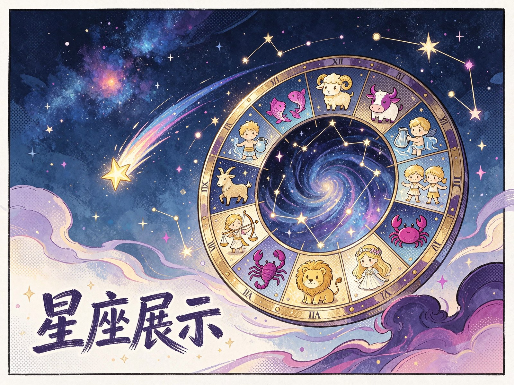

<p align="center"></p>

<h1 align="center">星座奥秘 · Zodiac Showcase</h1>

<p align="center">十二星座的星空互动展示页，点一个星座看它的性格与故事</p>

<p align="center">
  <a href="http://zodiac.aikex.ink/">在线查看</a>
</p>

## 简介

一个以星盘为主体的展示页：十二宫围绕页面中心排布，每颗星点可点开详情，显示星座符号、日期区间与性格描述。视觉上以深空渐变打底，配合星点闪烁与流星动效。

## 功能

- **星盘导航**：十二星座按黄道顺序环绕排布
- **详情面板**：点选后展示星座符号、时间区间与特质说明
- **动效**：星点呼吸、流星划过、面板淡入
- **响应式**：桌面与手机都能完整浏览
- **纯静态**：改数据文件即可替换内容

## 技术栈

HTML5 · CSS3（渐变、动画、Grid）· 原生 JavaScript

## 快速开始

直接用浏览器打开 `index.html`，或用任意静态服务器托管：

```bash
python -m http.server 8080
```

## 项目结构

```
index.html    页面结构
css/          星空样式与动效
js/           数据与交互
```

## 说明

星座内容为通用科普描述，仅供娱乐参考。

## 许可证

仓库未附 LICENSE 文件，使用与分发请先联系作者确认。
